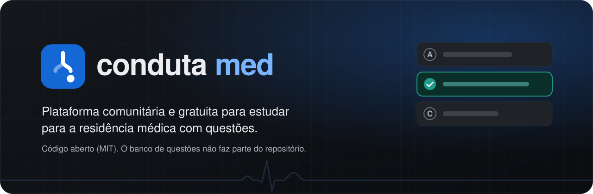
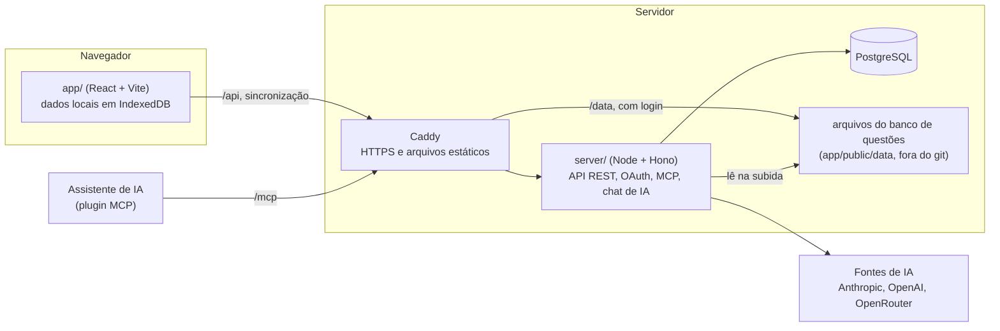

<p align="center">
  
</p>

<p align="center">
  <a href="LICENSE"></a>
  
  
  
  
  
</p>

# Conduta Med

O Conduta Med é uma plataforma comunitária e gratuita para estudar para a prova de residência médica resolvendo questões. A pessoa monta listas, faz simulados no tempo da prova, acompanha o próprio desempenho, organiza um cronograma, revisa com flashcards e pode estudar junto com outras pessoas.

Este repositório tem o **código** da plataforma inteira: o app web, a API, o design system e o plugin para assistentes de IA.

## O que não está aqui

**O banco de questões e todo o conteúdo de estudo não fazem parte deste repositório.** Isso inclui enunciados, gabaritos, explicações, resoluções, resumos de assuntos, figuras, transcrições e vídeos de correção.

O motivo é simples: o código é nosso e pode ser aberto; o conteúdo não. Provas e materiais de estudo têm autores e direitos próprios, e cada instância precisa cuidar do próprio conteúdo. Para você conseguir rodar e testar a plataforma, a pasta [`exemplo/`](exemplo) traz 20 itens fictícios, sem nenhum conteúdo médico ("Questão de exemplo 1: qual destas letras é a A?").

Se você vai montar uma instância com conteúdo real, use só material que você tem direito de usar.

## O que a plataforma faz

- **Questões**: listas por área, especialidade, tema, banca e ano; correção na hora ou no fim; anotações e questões salvas; busca no texto.
- **Simulados**: a prova inteira no tempo oficial, com resultado por área e histórico.
- **Hoje e cronograma**: meta diária, sequência de dias, calendário com plantões e folgas, plano que se ajusta quando a pessoa atrasa.
- **Desempenho**: acertos por área e tema, mapa de calor dos dias de estudo, padrões de erro.
- **Flashcards**: repetição espaçada, importação de baralhos do Anki (`.apkg`, lido no navegador), cards criados a partir dos erros, baralhos compartilhados.
- **Resumos**: editor de texto rico para a pessoa escrever os próprios resumos, com pastas, lixeira e compartilhamento.
- **Assuntos**: leitura de resumos por assunto, quando a instância tiver esse conteúdo.
- **Treino de anatomia**: jogo com modelos 3D leves no navegador.
- **Pessoas**: perfis, pedidos para seguir (com aceite) e comentários nas questões, sem feed e sem ranking.
- **Chat de IA e análises com IA**: veja [Chat de IA](#chat-de-ia).
- **Plugin para assistentes de IA**: um servidor MCP com login por OAuth, para a pessoa usar a plataforma a partir do assistente dela (pasta [`plugin/`](plugin)).
- **Funciona sem internet** depois de carregado: o progresso fica no navegador e sincroniza com o servidor quando a conexão volta.
- **API de operação**: rotas para quem opera a instância cuidar de pessoas, uso, suporte, configuração de IA e de e-mail e estado do servidor. O painel que usa essas rotas não faz parte deste repositório.

## Arquitetura



- O banco de questões não fica no Postgres: são arquivos JSON que o servidor carrega na memória e que o app baixa aos poucos (um índice leve e o corpo das questões por prova). Em produção, esses arquivos só são servidos para quem tem conta.
- O Postgres guarda contas, progresso, flashcards, resumos, comunidade, uso de IA e configurações. O esquema está em [`server/migrations/`](server/migrations) (SQL escrito à mão, aplicado quando o servidor sobe).
- Chaves de API e a senha do e-mail são guardadas cifradas no banco, com a chave `SECRETS_KEY` do ambiente.

## Mapa de pastas

| Pasta | O que tem |
| --- | --- |
| `app/` | o app web (React 19, Vite, Zustand, TipTap, three.js). `src/features/` tem uma pasta por seção |
| `app/scripts/` | `dividir_banco.py` (gera o índice e os arquivos por prova), `gerar_amostra.mjs` (questões da tela de entrar), modelos 3D do treino |
| `server/` | a API (Hono, `pg`, Zod), o servidor MCP, OAuth, chat e análises com IA, e os testes (Vitest) |
| `server/migrations/` | o esquema do Postgres, em ordem |
| `design-system/` | tokens de cor, tipografia e movimento, componentes, ícones, fontes e os scripts que geram tudo |
| `plugin/` | o plugin para assistentes de IA (skills e configuração do MCP) |
| `deploy/` | Caddy, Docker Compose, cópia diária do banco e o script de publicação |
| `exemplo/` | dados fictícios para rodar localmente |

## Como rodar localmente

Você vai precisar de **Node 22** ou mais novo, **Python 3** e **PostgreSQL** (15 ou mais novo; em produção usamos o 17).

**1. Postgres.** O jeito mais rápido é pelo Docker:

```bash
docker run -d --name conduta-pg -p 5544:5432 \
  -e POSTGRES_USER=conduta -e POSTGRES_PASSWORD=conduta -e POSTGRES_DB=conduta \
  postgres:17-alpine
# banco separado para os testes
docker exec conduta-pg createdb -U conduta conduta_test
```

**2. Dependências.**

```bash
(cd server && npm ci)
(cd app && npm ci)
```

**3. Configuração do servidor.** Copie o modelo e preencha os dois segredos:

```bash
cp server/.env.example server/.env
openssl rand -hex 32   # cole em CONFIRM_SECRET
openssl rand -hex 32   # cole em SECRETS_KEY
```

Em `ADMIN_EMAILS`, ponha o e-mail com que você vai criar a sua conta: quem entra com ele pode usar as rotas de operação da API (`/api/admin/...`).

**4. Dados de exemplo e arquivo do leitor de Anki.**

```bash
python3 exemplo/carregar.py
cp app/node_modules/sql.js/dist/sql-wasm.wasm app/public/
```

O primeiro comando copia os 20 itens fictícios para `app/public/data/` e gera o índice e a amostra da tela de entrar. O segundo é o arquivo que o app usa para ler baralhos do Anki.

**5. Esquema do banco.** As migrações rodam sozinhas quando o servidor sobe. Para rodar antes, à parte:

```bash
(cd server && npm run migrate)
```

**6. Os dois servidores de desenvolvimento**, cada um no seu terminal:

```bash
cd server && npm run dev    # API em http://127.0.0.1:8300
cd app && npm run dev       # app em http://127.0.0.1:5180
```

Abra o app, crie uma conta com o e-mail que você pôs em `ADMIN_EMAILS` e pronto. O app repassa `/api` para a API, então não precisa configurar mais nada.

### Testes

```bash
cd server && npm test
```

Os testes rodam contra o banco `conduta_test` (mude com `TEST_DATABASE_URL`) e usam os dados de exemplo em `app/public/data/`. Parte da bateria de testes original depende do banco de questões real e não está neste repositório.

### Publicar num servidor

A pasta [`deploy/`](deploy) tem o que usamos: Caddy na frente, API e Postgres no Docker Compose, cópia diária do banco por um timer do systemd. Copie `deploy/.env.example` para `.env` ao lado do `docker-compose.yml` no servidor, troque os domínios de exemplo do `Caddyfile` pelos seus e rode `deploy/deploy.sh` com `VPS_HOST` (e, se precisar, `VPS_KEY`) definidos.

## Chat de IA

O app tem um chat de IA que responde usando ferramentas sobre os dados da própria plataforma (as mesmas do plugin): buscar e ler questões, ver o desempenho e os erros da pessoa, o cronograma, os flashcards e os resumos dela. O modelo não inventa a partir do nada: ele consulta, e as respostas apontam para as questões e telas do app.

- **Limites por pessoa**: o operador liga ou desliga o chat para cada pessoa e define quantas mensagens por dia ela pode mandar, além de um crédito mensal.
- **Medição completa**: cada resposta guarda a fonte usada, o modelo, os tokens de entrada, saída e cache, quantas idas ao modelo e chamadas de ferramenta foram precisas, e o custo. Tudo sai pelas rotas de operação da API.
- **Fontes**, escolhidas pelo operador para a instância toda e, se quiser, para cada pessoa:
  - chave de API da **Anthropic**;
  - chave de API da **OpenAI**;
  - chave de API da **OpenRouter**, com qualquer modelo que ela oferece.
- **Fonte reserva**: se a fonte padrão falhar, a resposta sai por outra, e isso fica registrado.
- As chaves ficam cifradas no banco (AES-256-GCM) e a API devolve só o começo e o fim de cada uma.

**Cada operador é responsável por seguir os termos do provedor que conecta.**

As análises com IA (o resumo do resultado de um simulado e a sugestão de flashcards a partir dos erros) usam a mesma configuração de fontes e a mesma medição.

## Como contribuir

Leia o [CONTRIBUTING.md](CONTRIBUTING.md). Em resumo: abra uma issue antes de mudanças grandes, mantenha o estilo do código que já existe, rode os testes e nunca envie conteúdo de prova real, material de terceiros ou segredos.

Encontrou uma falha de segurança? Não abra issue pública: veja o [SECURITY.md](SECURITY.md).

## Licença

O código está sob a [licença MIT](LICENSE).

Partes de terceiros mantêm as próprias licenças:

- os modelos 3D do treino (`app/public/treino/*.bin`) derivam do BodyParts3D, © The Database Center for Life Science, sob a licença CC Attribution-Share Alike 2.1 Japan, e seguem sob a mesma licença;
- as fontes Hanken Grotesk e Literata estão sob a SIL Open Font License;
- as dependências do npm seguem as licenças de cada pacote.

O nome e a marca Conduta Med identificam o projeto. Se você publicar uma instância sua, use outro nome e outra marca.
